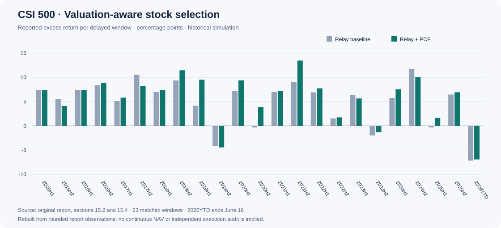

# 中证500机器学习选股研究

**围绕市场变化中的模型适应性，研究时间衰减加权、半年模型接力与估值过滤。**

[English](../README.md) · [英文研究报告](RESEARCH_REPORT.md) · [实验路线与证据](EXPERIMENT_HISTORY.md) · [结果明细](../results/RESULTS.md) · [时间协议](METHODOLOGY.md)

原始程序下载：[CSI 500 Quantitative Program Based on Python and Qlib](../Financial-Quantification-of-CSI500-main%20%281%29.zip)。该压缩包保留原文件，与研究展示文档分别提供。

## 项目研究了什么

本项目以中证500股票为研究对象，以 Qlib Alpha158 与 LightGBM 为基础，逐步研究收益标签、附加特征、近期样本加权、滚动重训、组合换仓和风险控制。最终展示的核心配置是 `HL378_MW2e4_T40_D2`，并比较是否加入 PCF 估值过滤。

项目的价值既包括模型和回测实现，也包括实验决策过程：识别基线在不同年份的失效、比较半衰期、检验因子子集、记录风险重排的过度干预，以及放弃收益不稳定的规则。

## 方法概览

| 环节 | 实现 |
|---|---|
| 输入 | Alpha158，加10个波动、振幅、量能与 VWAP 特征 |
| 标签 | 未来20个交易日收盘价收益 |
| 模型 | LightGBM，近期样本权重更高 |
| 加权 | 半衰期378个自然日；未归一化权重下限0.0002 |
| 组合 | 目标持有40只；TopkDropout 的 `n_drop=2` |
| 估值过滤 | 原始排名36—40且 PCF 位于当日Top100最贵10%的股票降分 |
| 时间处理 | 按作者说明，等待20个交易日，第21日才进入实际建仓阶段 |
| 数据维护 | 日常数据更新、估值覆盖检查、哈希记录与发布前验收 |

## 已有结果

新增：[真实运行与交易证据](../results/VALIDATION.md)。独立入口已运行第21日现金建仓、普通/双倍成本比较，并导出订单、成交和持仓。它与下面的历史窗口统计分别展示。



从原始报告第15章提取的23个配对窗口中：

- 接力基线平均窗口收益为 **9.34%**，PCF版本为 **10.21%**。
- 平均窗口超额分别为 **4.90** 和 **5.77个百分点**。
- PCF版本在 **16/23** 个窗口收益更高，2个窗口持平。
- 2026YTD两个版本均跑输基准，保留展示。

这些是延后20个交易日后的窗口统计，**不是年化收益，也不是完整连续账户的收益**。数字来自现有报告的四舍五入明细；没有在本次整理中重新运行完整回测。完整指标、来源与补充2026H1记录见[结果页](../results/RESULTS.md)。

## 如何阅读

1. 用[英文研究报告](RESEARCH_REPORT.md)了解研究问题、方法和结论。
2. 用[实验路线](EXPERIMENT_HISTORY.md)查看成功与失败的探索及对应原始证据。
3. 用[时间协议](METHODOLOGY.md)理解20日等待、新旧预测拼接和第21日建仓。
4. 用[复现指南](REPRODUCIBILITY.md)区分可直接重建的展示结果与需要额外数据的训练回测。

## 如何验证

在仓库根目录执行，Python 3.10及以上，无需安装第三方依赖：

```bash
python tools/build_showcase.py --check
python tools/import_research_archive.py --check
python tools/verify_execution_artifacts.py --run results/execution_2025H1
```

原始交易代码和历史回测报告保留；新增内容负责组织、解释和展示已有成果。技术发布的验收条件见[交付标准](RELEASE_STANDARD.md)。
